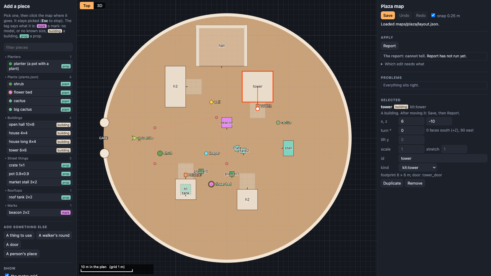
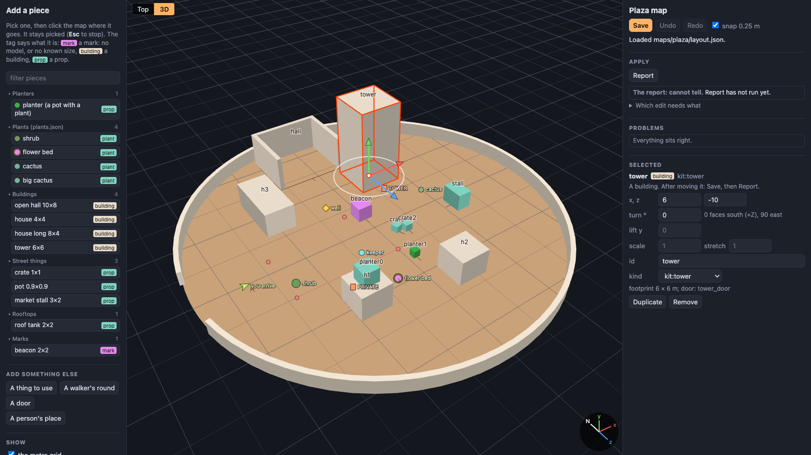
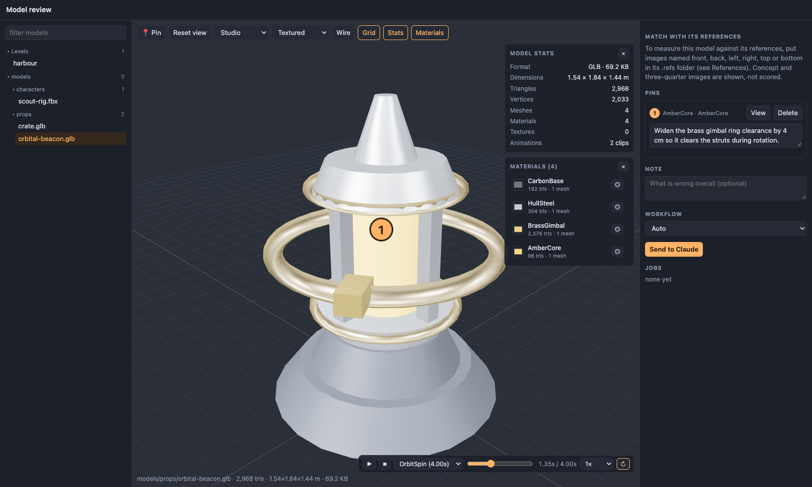

# NFGames Map Editor

A map editor that runs in your browser and edits a game map's plan, seen from above. A plan is one
JSON file per map (`layout.json`), plus an optional planting plan (`plants.json`). In the editor you
can move, turn, size, add and remove pieces, and move where the player arrives, people, things to
use and walkers' rounds. You can also write the text on doors and things, and place plants. Save
checks the plan against a JSON Schema, writes it atomically and keeps the old file as a backup. A fit
check warns about pieces standing in each other, things outside the map, blocked doors and similar. A
**3D view** shows the same plan as boxes, where you lift pieces onto roofs and move them along x, y and z.
A **model viewer** shows the game's models (GLB): pin what is wrong on a model, add notes and reference images,
and send it to a Claude Code session that fixes it and reports back (see [Model review](#model-review)). Both are
tabs of one **workbench**, under one bar with **Open project…**, which browses your home folder for another project
to open, and a project's models appear in the palette as kinds of piece by themselves.

The editor's core works for any game. Anything specific to one game lives in a **project config file**
(`map-editor.config.mjs`): where its kinds of piece and their sizes come from, its own compile and
checks, extra layers to draw, and **Apply** buttons that run the project's own build steps.

It runs on your machine only: the server listens on `127.0.0.1` and refuses everything else (see
[Security model](#security-model)).





## Contents

- [Requirements](#requirements)
- [Install](#install)
- [Quick start with the example](#quick-start-with-the-example)
- [Running it against your own project](#running-it-against-your-own-project)
- [Opening a project](#opening-a-project)
- [The config file](#the-config-file)
- [The map file format](#the-map-file-format)
- [Using the editor](#using-the-editor)
- [Model review](#model-review)
- [New model](#new-model)
- [Plugins](#plugins)
- [Save and backups](#save-and-backups)
- [The fit check](#the-fit-check)
- [Apply actions](#apply-actions)
- [Security model](#security-model)
- [Troubleshooting](#troubleshooting)
- [Tests](#tests)
- [Licence](#licence)

## Requirements

- **Node.js 20 or later.** The editor has no runtime dependencies.
- **A desktop browser.** Chrome, Edge and Firefox all work; the page is plain HTML, a 2D canvas, and WebGL for the 3D view.
- Windows, macOS and Linux are all supported. Only Node is needed, and no shell scripts are involved.

## Install

```sh
git clone <this repository> NFGames-Map-Editor
cd NFGames-Map-Editor
npm install        # nothing to download: it only sets up the package
```

## Quick start with the example

```sh
npm start
```

Then open **http://127.0.0.1:8793/** (the workbench; `/map` and `/viewer` open it on that tab, and `?alone` after either gives the bare page, as scripts use). `npm start` serves `examples/sample/`, a small walled square.
It has a tower, three houses, an open hall, a market stall, crates, two planters, a beacon, a person,
a door, a walker's round, a well and three plants. The sample config uses each kind of option and
hook once, including a **Report** Apply action and a status panel.

If 8793 is already in use (another editor, say), pick another port:

```sh
npm start -- --port 8794
```

The model viewer is **Model viewer** in the bar (or **http://127.0.0.1:8793/viewer**). The sample has no models: set `models` in a
project's config (see [Model review](#model-review)) to point it at a folder of `.glb` files.

Everything the example writes goes into `examples/sample/maps/plaza/` and `examples/sample/out/`.
`git checkout examples/sample` puts it back.

## Running it against your own project

A **project** is any folder that contains maps:

```
my-game/
  map-editor.config.mjs     optional: what this project's maps need (see below)
  kit.json                  optional: the kinds of piece and their footprints
  maps/                     or data/maps/, or whatever `maps` in the config says
    town/
      layout.json           the plan (required)
      plants.json           the planting plan (optional)
    cave/
      layout.json
```

Start the editor on it, from anywhere:

```sh
node <path to NFGames-Map-Editor>/bin/nfgames-map-editor.mjs --project my-game
```

You can also install it into the project and use the `nfgames-map-editor` command. The package is
private (not on the npm registry), so install it from a folder or from git:

```sh
cd my-game
npm install --save-dev ../NFGames-Map-Editor      # or a git URL
npx nfgames-map-editor --project .
```

### Command line

```
nfgames-map-editor [map] [--project <dir>] [--config <file>] [--port <n>] [--dry-run]
```

| Option | Default | |
|---|---|---|
| `map` | the config's `defaultMap`, else the first map (by name) | the map the page opens first. The page can switch maps from a list (top right) when there are several |
| `--project <dir>` | the current folder | the project whose maps to edit |
| `--config <file>` | `<project>/map-editor.config.mjs`, when there is one | a config file kept somewhere else (relative paths in it still count from the project) |
| `--port <n>` | the config's `port`, else `MAP_EDIT_PORT`, else 8793 | the port on 127.0.0.1. Use another port to run a second editor beside the first |
| `--dry-run` | off | Apply actions' heavy steps only print what they would run |

### With no config

With no config file the editor still works:

- maps are read from `<project>/maps/`, or `<project>/data/maps/` if only that exists;
- plans are checked against the editor's built-in schema (`schemas/map.schema.json`), and
  `plants.json` against `schemas/map-plants.schema.json`;
- kinds of piece come from `<project>/kit.json` when there is one (see [Kinds](#kinds-and-kitjson)),
  plus any `sizes` a plan lists itself. A kind with no known size is drawn as a 2 x 2 m mark;
- the built-in fit check runs; there are no Apply buttons, extra layers or status panels.

## Opening a project

The workbench's bar is the same in every view: the views (**Home**, **Map editor**, **Model viewer**; a dot on
Map editor means unsaved changes), then the open project's name, which opens **Open project…**. Every view always
shows the same project, the one the editor's server has open; `--project`
sets the first.

**Open project…** browses the folders under your **home folder** (hidden folders such as `~/.ssh` are left out). It
shows folder names and two markers, never file contents: **project** (the folder has a `map-editor.config.mjs`, a
`maps/` or a `data/maps/`) and **N models** (`.glb` files directly in it). Recent projects are listed at the top
(`~/.nfgames-editor/recent.json`). Any folder opens; one with no config uses the defaults: maps from `maps/` (or
`data/maps/`), models from `models/` if it has one, else from the folder itself.

**Trusting a config.** A `map-editor.config.mjs` is code the editor runs. The first time you open a folder with one, the
dialog names the file and asks before running it (**Run its config and open**). The answer is kept in
`~/.nfgames-editor/trusted.json`, for that folder and that file, with the file's hash: if the config changes, it asks
again. What you trust is the folder, as with an editor's workspace trust: a config may import other files of its
project, and changing those does not ask again. The project the editor is started on is trusted, since its config has
already run.

A project with **no maps** opens too: the editor says so, and the model viewer works as usual. Opening is refused while
an Apply job runs, and a config that fails keeps the project that was open. Unsaved map changes are asked about first.

## The config file

`map-editor.config.mjs` in the project root is an ES module. Its default export is either an object,
or a function (which may be async) that receives `{ root, editorRoot }` and returns one. Use the
function form when the config needs to import the game's own modules from the project
(`examples/thoon-run.config.mjs` does this). Paths in the config are relative to the project root.

A short example:

```js
// map-editor.config.mjs
export default {
  maps: 'data/maps',
  defaultMap: 'town',
  kit: 'art/kit.json',
  schema: 'data/schemas/map.schema.json',
  classes: { building: { tag: 'building', colour: '#e9dccb', legend: 'a building', note: 'Rebuild after moving it.' } },
  plants: { kinds: { shrub: ['shrub', 1] }, labels: { shrub: 'shrub' } },
  actions: {
    build: { label: 'Build', steps: [{ label: 'compile the map', node: ['tools/compile-map.mjs', '{map}'] }] },
  },
};
```

`examples/sample/map-editor.config.mjs` is a complete working config.
`examples/thoon-run.config.mjs` shows a large real setup: how Thoon Run's game-specific editor maps
onto these options.

### Options

| Option | Default | What it does |
|---|---|---|
| `title` | `"map editor"` | the browser tab's title |
| `maps` | `maps/`, else `data/maps/` | the folder holding one folder per map |
| `defaultMap` | the first map | the map opened when none is named |
| `port` | 8793 | the port (the command line's `--port` and `MAP_EDIT_PORT` win) |
| `schema` | the built-in `schemas/map.schema.json` | the JSON Schema `layout.json` must pass. `$ref`s to other files are read from beside it |
| `kit` | `"kit.json"` | a kit file listing the kinds of piece (ignored when `kinds` is given). `null` for none |
| `kinds` | | hook: the kinds of piece, instead of a kit file (see [Hooks](#hooks)) |
| `palette.groups` | | `[{ title, match }]`: palette headings, in order. `match` is a RegExp tested on the kind's name, or a function `(kind, info) => boolean`. A kind's own `group` wins over these |
| `classes` | `piece`, `mark` | `{ <cls>: { tag, colour, legend, note } }`: how each class of kind (a kind's `cls`) is tagged and coloured in the palette, filled on the map, described in the legend, and noted when a piece is selected |
| `presets` | | palette entries that add a piece of a series: `[{ id, label, group, kind, scale?, idPrefix, colour, note, when? }]`. The piece gets the next free id `<idPrefix>0`, `<idPrefix>1` ... and is drawn in `colour` with a dot. `when: { field, equals }` limits the preset to plans whose top-level `field` equals `equals` |
| `reservedIds` | | a RegExp: piece ids kept for what the project's tools make. A plan that uses one does not save, unless the piece belongs to an active preset's series |
| `display` | plan's metres | `{ planScale, kindScale, defaultKindScale, attach, wallThickness, snap, gameLabel }`, or a function `({ name }) => {...}` for per-map values. Use it when the game draws the plan larger: `planScale` scales positions about the map's centre, `kindScale` (by kind, else `defaultKindScale`) scales pieces, and `attach` (`{ pieceId: hostId }`) keeps a piece on its host at the host's scale. Footprints are then drawn at the game's size, and coordinates are shown in both frames, labelled `gameLabel`. `snap` is the snap step in metres (default 0.25). `wallThickness` is the ring wall's drawn thickness in metres |
| `plants` | on, built-in schema | `false` turns the plants layer off. Otherwise an object: `schema` (for `plants.json`), `kinds` (`{ name: [builtAs, sizeFactor] }`: the kinds a hand-placed plant can be), `labels` (`{ name: text }`: when given, the palette lists these kinds in this order), `draw` (`{ builtAs: { r, fill, ring?, star? } }`: radius in metres, colour, a pot's rim colour, or the number of points of a star), `pointKindOf` (built kind to point kind, for rule-made plants), `excludeRadius` (0.6 m), `clearance` (0.6 m off a round), `tall` and `tallClearance` (1.0 m), `debris` and `follows` (rule-made kinds and rules drawn but not pickable), and the `ruleMade` hook |
| `validate` | | hook: more errors that stop a save |
| `compile` | | hook: the project's compile, run on every preview |
| `compileLayers` | | `[{ id, label, on?, legend? }]`: names and legends for the layers the compile returns |
| `builtInCheck` | `true` | `false` turns off the built-in fit check (use when `check` replaces it) |
| `check` | | hook: the project's own warnings |
| `status` | | hook: status panels ("is what the tools last built still the plan on screen?") |
| `overlays` | | `{ <id>: { label, on?, lazy?, legend?, load } }`: read-only layers the project draws from its own files |
| `beforeSave`, `afterSave` | | hooks around a save |
| `actions` | | the Apply buttons (see [Apply actions](#apply-actions)) |
| `help` | | `[[what, how], ...]`: the "Which edit needs what" table under Apply |
| `hints` | | short texts the page shows: `afterSave: { plan, plants, both }` after a save that changed those files, `ring`, `person`, `thing`, `plant`, `round` in the matching Selected panels |
| `models` | `models/`, else the project's folder | the folder whose `.glb` files the [model viewer](#model-review) lists and the palette offers (subfolders included, `node_modules` and hidden folders skipped). Must be inside the project. `false` for none |
| `modelKinds` | `true` | `false`: the models folder's files are not offered as kinds of piece |
| `reviews` | `.review` | the folder review jobs are written to. Must be inside the project |
| `reviewWorkflows` | Auto, Blender, ComfyUI | the viewer's Workflow list: `[{ id, label, description, enabled, instructions, instructionsFile }]`, or a default's id (`'auto'`). `instructions` is text; `instructionsFile` is a file in the project whose text is added. Both are copied into each job. `enabled: false` shows "(not set up yet)". Blender and ComfyUI are placeholders by default (see `todo.md`) |

### Hooks

Every hook may be async. Its second argument, `ctx`, carries the project's paths and the editor's own
helpers, so a config never needs to import the editor:

```
ctx = { root, editorRoot, mapsDir, mapDir(name), planFile(name), plantsFile(name), readPlan(name), readPlants(name),
        readJson(file), rel(file), formatPlan(plan), formatPlants(plants), fileStamp(file), dryRun }
```

| Hook | Called with | Returns |
|---|---|---|
| `kinds({ name, plan }, ctx)` | when the page loads, and on every preview and save | `{ <kind>: kind }` (see [Kinds](#kinds-and-kitjson)) |
| `validate({ plan, name }, ctx)` | after the schema passes, before every preview and save | `["error text", ...]`: errors that stop a save |
| `compile({ plan, plants, name, kinds }, ctx)` | on every preview (each edit, about four times a second at most) | anything. The editor reads `overlays` (`{ <layerId>: { label?, shapes } }`), `seated` (`{ pieceId: y }`, shown as "seated at" for lifted pieces) and `log`. The whole result is passed to `check` as `built`. If it throws, the page shows "the compile failed" as an error |
| `check({ plan, plants, built, name, kinds }, ctx)` | after `compile` | `[{ kind, text, sel, at }]` warnings (see [Problems](#problems)) |
| `status({ plan, plants, built, name }, ctx)` | after `check` | `[{ title, state: 'fresh' \| 'stale' \| 'unknown', basis?, changes?: [{ id, what, sel }], action? }]` |
| `beforeSave({ name, plan, plants }, ctx)` | after the checks pass, before writing | |
| `afterSave({ name, plan, plants, changed }, ctx)` | after writing (with the plan as read back from disk) | |
| `overlays.<id>.load({ name, plan }, ctx)` | when the page loads (lazy ones when first shown) and after every finished Apply action | `{ present, shapes?, note? }`. `note` is shown in the map's top-right corner |
| `plants.ruleMade({ name, plan }, ctx)` | when the page loads and after every Apply action | `{ present, items: [{ kind, at, rule?, rotDeg?, scale?, source? }], file?, why? }`: plants made by the project's rules, in the plan's frame |
| action hooks | see [Apply actions](#apply-actions) | |

### Kinds and kit.json

**Models as kinds.** Every `.glb` under the project's `models` folder is a kind in the palette, with no `kit.json`
entry needed. It is named `model:<file name>` (lower case, other characters as `_`, an `m` in front of a leading
digit; where two files would share a name, their folders are added: `model:ships_crate`, `model:ruins_crate`). Its
footprint comes from the model's own bounds, read from the GLB's header without loading the model (glTF metres, Y up,
the editor's frame; quantized positions, as Meshopt writes them, are read as the GPU draws them), and its box sits
where the model is when the model's origin is not at its middle. A part turned inside the model makes the box a little
larger than the model, since only the parts' own boxes are read. Models are
listed under **Models**, by folder, in the class `model` (teal). Each file is read once per version. A `kit.json`
entry of the same name wins (a `size` there without `boxes` uses the whole footprint), so a footprint, `door` or
`solid` can be set by hand. A file that cannot be read is a kind of unknown size (2 x 2 m) with a `model` problem
naming it. A model piece's Selected panel has **View model**, which opens it in the model viewer. In the 3D view
models are still drawn as boxes.


A **kind** is a kind of piece (`kit:house`, `hero:tower`, or a plain name), with its footprint:

```json
{
  "kit:house": { "size": [4, 4, 3.5], "door": [0, 2.8], "cls": "building", "group": "Buildings" },
  "kit:hall":  { "size": [10, 8, 5], "boxes": [[0, -3.7, 10, 0.6], [-4.7, 0, 0.6, 8], [4.7, 0, 0.6, 8]], "label": "open hall" },
  "mark:beacon": { "cls": "mark" }
}
```

| Field | | |
|---|---|---|
| `size` | `[w, d, h]` metres | the footprint's width (along its own x), depth (along its own z) and height. Without it the kind is "unknown", drawn as 2 x 2 m and treated as not solid |
| `boxes` | `[[x, z, w, d], ...]` | where it is solid, in its own frame (front +Z). Default: the whole footprint. An open hall lists its walls, so you can place and walk things inside it |
| `door` | `[x, z]` | the spot in the street just outside its door, in its own frame. Doors can hang on pieces of this kind, and the fit check keeps that spot clear |
| `cls` | `"piece"` (`"mark"` when unknown) | its class: how the palette tags and colours it (config `classes`) |
| `group` | | the palette heading it goes under |
| `label` | | the palette's name for it (default: the part after the colon, with spaces for `_`) |
| `hidden` | | not in the palette (pieces a compile lays out itself) |
| `solid` | `true` | `false`: people and things may stand in it (a lantern, a palm) |
| `across` | | the fit check allows it beyond the ring or bounds |
| `mayOverlap` | `[kind, ...]` | kinds it may stand in (a ship in its hangar) |
| `deck` | `size[2]` | the height a lifted piece stands at on top of it |

Keys starting with `$` are ignored, so a kit file can carry a `$note`. A plan's own `sizes` add kinds,
or override a kind's size.

### Overlays: shapes a project draws

`compile` results and `overlays` loaders return `shapes`, in the **plan's** metres (convert from your
game's frame first). The page draws them under the pieces, except `grid` shapes and those marked
`over: true`:

| `type` | fields |
|---|---|
| `rect` | `at`, `w`, `d`, `rot` (degrees), `fill?`, `stroke?`, `lw?`, `dash?` |
| `circle` | `at`, `r` (metres), `minPx?`, `fill?`, `stroke?`, `lw?`, `dash?` |
| `line` | `pts: [[x, z], ...]`, `stroke`, `width` (metres) with `minPx?`, or `px`; `closed?`, `round?`, `dash?` |
| `dot` | `at`, `px`, `fill` (a square of fixed size on screen) |
| `label` | `at`, `text`, `colour?`, `size?` |
| `grid` | `min: [x, z]`, `cell` (metres), `cols`, `rows`, `data` (base64 of one little-endian uint16 per cell, row by row), `none` (the value meaning no ground), `scale`, `offset` (height = value / scale - offset), `solidAbove` (0.3). Cells with no ground are drawn dark blue, raised cells paler |

Colours are CSS colours. `dash: true` draws a 4-3 dash; an array gives your own dash pattern.

### Problems

Warnings from the fit check and from `check` are `{ kind, text, sel, at }`. `kind` is a short word
shown in bold, `text` says what is wrong, and `at` is `[x, z]` (where clicking the warning pans to).
`sel` lists what clicking it selects, as selection keys: `piece:<id>`, `spawn`, `person:<id>`,
`thing:<id>`, `door:<id>`, `route:<round>:<point>`, `plant:<index>`, `exclude:<index>`.

## The map file format

### The frame

Every number is in **metres**. **+X is east, +Z is south, Y is up.** Positions are `[x, z]`. A rotation
`rot` is in **degrees about Y**: 0 faces +Z (south), 90 faces +X (east), -90 faces -X (west). A piece's
front (its own +Z) turns to `(sin rot, cos rot)`. On screen north is up, so screen right is +X and screen
down is +Z. Each file states its frame in `frame`, so nobody has to guess.

### layout.json

| Field | | |
|---|---|---|
| `id` | required | the map's folder name |
| `name` | required | the name shown |
| `frame` | required | `{ "units": "metres", "x": "east", "z": "south", "up": "y", "rot": "degrees" }` and an optional `note` |
| `ring` or `bounds` | one is required | `ring: { centre: [x, z], radius, gateWidth?, pillarEvery? }`: a round map inside a ring wall, open for `gateWidth` metres at `gate`, with a pier every `pillarEvery` metres. `bounds: { min: [x, z], max: [x, z] }`: a rectangular map with no wall |
| `spawn` | required | `{ at: [x, z], yaw }`: where the player arrives, facing `yaw` degrees |
| `pieces` | required | `[{ id, kind, at, rot, y?, scale?, stretch?, seat?, note? }]` (see below) |
| `games` | | which games use it (strings) |
| `note` | | where the plan came from |
| `gate` | | `[x, z]`: the way out, on the ring |
| `kindScale` | | `{ "<kind>": factor }`: a size for every piece of a kind |
| `sizes` | | `{ "<kind>": [w, d, h] }`: a footprint for a kind the kit does not list (or to override it) |
| `marks` | | `[{ id, kind, at, rot?, y?, scale? }]`: places for things with no model, drawn by the game's code |
| `people` | | `{ "<id>": [x, z] }` (or `{ at, facing }`): where named people stand |
| `doors` | | `[{ id, piece?, at?, sign?, label?, room?, needs?, lockedText?, shut? }]`: a door hangs on a `piece` (and stands at its kind's `door` spot) or stands free `at` a point. `room` is where it leads; `needs` is what opens it (a string or a list); `lockedText` is what it says while locked; `shut` is what a door that never opens says |
| `routes` | | walkers' rounds: `[[[x, z], ...], ...]`, each a closed loop of at least two points |
| `things` | | `[{ id, label, at, radius, action?, card?: { title, body } }]`: things to walk up to and use or read, within `radius` metres |

A **piece** has an `id` (lower case letters, digits, `_` and `-`, unique among pieces and marks), a
`kind`, `at` and `rot`. `y` lifts it (onto a roof, say: the editor treats `y > 0.5` as lifted). `scale`
sizes it (over `kindScale`). `stretch` lengthens it along its own x only. `seat` is for a project's
compile (false: keep `y` as written).

Other top-level sections are allowed and kept: a project can add what it needs. The file is always
written the same way (keys in a fixed order, one piece per line), so moving one piece shows as one
changed line in a diff.

### plants.json

| Field | | |
|---|---|---|
| `points` | | plants placed by hand: `[{ kind, at, rot?, scale?, district? }]`. `kind` is one of the config's `plants.kinds`. `rot` is in degrees; leave it out to let the project choose. `district` is a free note |
| `exclude` | | places where the project's rules plant nothing: `[{ at, r, note? }]` (`r` in metres). Points are not affected |
| `note` | | |

Any other section (a project's planting rules, say) is kept as it is; the editor edits only `points` and
`exclude`. The file is written as two-space JSON with keys in a fixed order.

## Using the editor

The bare page (`/map?alone`) has three columns: the palette and layers on the left, the map in the middle, and the
map's state and the selection on the right. In the workbench the map takes the room instead: the left column is the
side panel; **Save**, **Undo**, **Redo**, snap, the map's name and the status line are a bar over the map, beside
**Top / 3D**; the map's Apply box and the selection are the **Inspector** (titled *Map* with nothing selected,
*Selected* otherwise); and problems are listed once, in the bottom panel's **Problems** tab, where a click pans to
one and selects it.

### The map

- **Top left**: the coordinates under the mouse, in the plan (and in the game, when `display` scales the
  plan). Hovering a plant also tells you what it is.
- **Top right**: notes from the project's layers (for example, when its generated files were made).
- **Bottom left**: a scale bar and the grid's spacing (1, 5 or 10 m, depending on zoom).
- The map's ground is drawn round (a ring map, with its wall, the gate's two posts and "GATE") or as a
  rectangle (bounds). Each piece is a rectangle with a short tick at its front. Where only some of it is
  solid (`boxes`), the solid parts are filled in. Lifted pieces are drawn see-through with a dashed edge.
  People are blue dots, things to use are yellow diamonds, doors are orange squares, walkers' rounds are
  dashed loops, and where the player arrives is a green arrow labelled "you arrive".

### Mouse

| Do | What happens |
|---|---|
| **Click** something | selects it |
| **Drag** something | moves it (and everything selected with it). The one under the mouse lands on the snap grid; the others keep their places beside it |
| **Drag empty ground** | pans (and clears the selection, unless Ctrl is held) |
| **Right or middle button drag**, anywhere | pans |
| **Wheel** | zooms about the mouse |
| **Shift drag** | box select: adds everything inside the box to the selection |
| **Shift click** or **Ctrl click** | adds one thing to the selection, or takes it out |
| **Drag the turn handle** (the white circle in front of a single selected piece) | turns it in 15° steps; hold **Alt** to turn freely, by 1° |
| **Click the map while a palette entry is picked** | places one there; the entry stays picked so you can place more |
| **Drag a rule-made plant** (zoomed in) | it becomes a plant placed by hand where you drop it, plus an exclusion where it stood |

Doors that hang on a piece cannot be dragged: they move with their piece. Rule-made plants can only be
picked when zoomed in far enough (6 pixels a metre or more). Debris kinds and plants that follow
something (config `plants.debris`, `plants.follows`) are drawn but cannot be picked.

### Keys

| Key | What happens |
|---|---|
| **R** / **Shift R** | turns the selected pieces and plants 15° one way or the other (with **Alt**: 1°). With only the arrival selected, turns which way the player faces |
| **Arrows** | nudges the selection one snap step (**Shift**: 1 m) |
| **Ctrl D** | duplicates the selected pieces (2 m away, with new ids) and plants (1 m away) |
| **Delete** or **Backspace** | removes the selection. A piece with a door on it is kept; move or remove the door first |
| **Ctrl Z** | undo |
| **Ctrl Y** or **Ctrl Shift Z** | redo |
| **Ctrl S** | save (this works even while typing in a field) |
| **Page Up** / **Page Down** | lifts or lowers the selected pieces one snap step (**Shift**: 1 m); never below the ground |
| **Tab** | switches between the top view and the 3D view |
| **F** | fits the whole map in view |
| **Esc** | stops placing; pressed again, clears the selection |

On a Mac, Cmd works in place of Ctrl. Keys other than Ctrl S are ignored while you type in a field.

### Left column

- **Add a piece**: the palette. The project's presets come first, then plants (`plants.json`), then the
  kinds of piece under their group headings, each with its size and its class tag. A heading opens and closes
  its group (models nest by folder under **Models**), and what is closed is remembered for the project. The
  filter above the palette shows only the entries whose name or kind matches, whatever is closed. Click an entry to pick
  it, then click the map wherever it should go. Click the entry again, or press Esc, to stop. A new piece
  gets an id from its kind's name (`house`, `house2` ...), a preset piece gets the next id of its series,
  and everything snaps to the grid.
- **Add something else**:
  - **A thing to use**: a new thing (`thing1` ...) at the middle of the view, with a radius of 2.5 m
    and an empty card to fill in.
  - **A walker's round**: a new square round of four points, 8 m across, at the middle of the view.
  - **A door**: with a piece selected whose kind has a `door`, a door hangs on it. With no piece selected,
    the door stands free at the middle of the view. It starts as sign `PRIVATE`, shut `Locked.`.
  - **A person's place**: asks for the person's id, then places them at the middle of the view.
- **Show**: one checkbox per layer: the metre grid (the same switch as the 3D view's grid, the model viewer's
  and **⌘G**), plants, walkers' rounds, people, things to use, doors,
  and names, plus any layers the project adds. A lazy layer is loaded the first time you tick it.
- **Legend**: what each colour means, including the project's own classes and layers.
- **Keys**: a short list of the mouse and keyboard controls.

### Right column

- **The map's name**, with a list to switch maps when the project has more than one. You can also open a
  map directly with `?map=<name>` in the address.
- **Save** (Ctrl S), **Undo**, **Redo**, and **snap** (on: positions snap to the snap step, 0.25 m by
  default; off: to 0.01 m). **unsaved** appears while there are changes not yet saved, and the browser
  asks before you leave the page with them.
- **The status line**: what just happened (loaded, saved, placed, an error).
- **Apply** (only when the project has actions): one button per action, a spinner with the running step
  and its time, the project's status panels, the "Which edit needs what" table (config `help`), and the
  last job's output. Action buttons are disabled while there are unsaved changes or a job is running.
  In each status panel, the names of changed things are links: clicking one selects it.
- **Problems**: what stops a save (red, marked "schema") and the warnings (see [The fit check](#the-fit-check)).
  Clicking a warning selects what it is about and pans to it. "Everything sits right." means none.
- **Selected**: the selection's own panel.
  - **Nothing selected**: the map itself. For a ring map: ring radius (changing it moves the gate onto the
    ring), gate width, and piers every so many metres. Then counts of pieces, doors, things, rounds and
    people, and the file's path.
  - **Several**: how many, their ids, **Duplicate** and **Remove**.
  - **A piece**: its id, class tag and kind, and its class's note. Then **x, z**, **turn °** (0 faces
    south, 90 east), **lift y** (and "seated at" when a project's compile sets the height), **scale**
    (empty: the kind's scale) and **stretch**. **id** renames it, and doors on it follow (taken or reserved
    ids are refused). **kind** changes it to another kind. Below that are its footprint in metres (and its
    place in the game, when scaled), the doors on it, and **Duplicate** and **Remove**.
  - **Where the player arrives**: **x, z** and **facing °**.
  - **A person's place**: **x, z** and **Remove**.
  - **A thing to use**: **x, z**, **radius** (metres to use it from), **id**, **label**, **action** (empty:
    it shows its card), the card's **title** and **what the card says**, and **Remove**.
  - **A door**: **on** (the piece it hangs on, from pieces whose kind has a door) with **Show** to select
    that piece, or **x, z** for a door standing free. Then **sign**, **label**, **room** (empty: it is
    shut), **needs** (comma-separated), **what it says while locked**, **what it says if it never opens**,
    and **Remove the door**.
  - **A plant placed by hand**: **kind**, **x, z**, **turn °** (empty: the project chooses), **scale**,
    **district**, any warnings about it, and **Duplicate** and **Remove**.
  - **An exclusion**: **x, z**, **radius**, and **Remove the exclusion**.
  - **A rule-made plant**: where it is and which rule made it, **Place it by hand here** (it becomes a
    point, plus an exclusion), and **Remove it** (an exclusion only).
  - **A point of a walker's round**: **x, z**, **Add a point after it** (halfway to the next point),
    **Remove the point** (a round needs two points: removing one of the last two removes the round), and
    **Remove the round**.

Every edit goes onto the undo stack, and the page re-checks the plan with the server a quarter second
after you stop editing. Nothing is written until you save.

### The 3D view

**Top** and **3D** over the map (or **Tab**, or `?view=3d` in the address) switch between the plan from above
and the same plan in 3D. Both views share the selection, undo and redo, the palette, Problems and the Selected
panel, so you can switch at any time. The 3D view needs WebGL; without it the 3D button is greyed out.

What it draws: the ground (a disc, or the bounds' rectangle), the metre grid over the whole floor, the ring wall (2 m high,
open at the gate), and every piece as solid boxes of its kind's `size` (one box per entry of `boxes`, at
full height, so an open hall is its walls), in its class's colour, standing at its `y`. A short line on the
ground marks each piece's front. People, things, doors, rounds, the arrival and hand-placed plants are the
top view's markers, lying on the ground. A compass in the corner shows x (red), y (green), z (blue) and north.

| Do | What happens |
|---|---|
| **Drag empty space** | orbits round the middle of the view |
| **Right or middle button drag** | pans along the ground |
| **Wheel** | zooms toward the ground under the mouse |
| **Click** something | selects it; **Shift** or **Ctrl click** adds it or takes it out |
| **Drag the red, green or blue arrow** | moves the selection along x, y (up) or z only. Things with no height (people, things, doors, rounds, the arrival, plants) have no green arrow |
| **Drag a box** | slides it (and the rest of the selection) over the ground, at its height |
| **Drag the white ring** | turns the piece in 15° steps (**Alt**: 1°) |
| **Click the map while a palette entry is picked** | places one where the see-through box shows: on the ground, or on the roof of the piece under the mouse. A drag still orbits |

The arrow keys nudge along the plan's axis nearest to that way on the screen; every other key works as in
the top view. Everything snaps to the snap step, on all three axes.

**Landing on things.** While you drag a piece up or down, it catches the top of the piece under its middle
when it comes within 0.3 m of it, and a palette entry placed on a roof stands on it. "The piece under it" is
what the fit check counts: a piece on the ground, of a known kind, not `solid: false` (the first in the file
when several are). So a piece put up this way raises no `float` warning. Nothing goes below the ground, and a
height of 0 is written as no `y` at all.

What it does not do (yet):

- It shows boxes, not the game's models.
- It does not land a piece on a piece that is itself lifted (the fit check does not accept that either);
  the green arrow and **lift y** still put a piece at any height.
- It shows the file's `y`. A project whose compile seats pieces itself ("seated at" in the Selected panel)
  may put them elsewhere in the game.
- The project's own layers and rule-made plants are drawn in the top view only. Box select is top view only.
- Maps a project draws larger (`display`) are drawn at the same sizes as in the top view; landing uses the
  plan's own sizes, so on such maps it is best effort.

## Model review



The **model viewer** (**Model viewer** in the bar, or `http://127.0.0.1:<port>/viewer`, which the editor prints on
start; `?model=<path>` opens one model, and says so when the project has no such file) shows a game's
models and sends what is wrong with them to a Claude Code session. Open a model, drop **pins** on the spots that
need fixing, write a note on each (drop or paste up to four reference images onto a pin), choose a **workflow**
and press **Send to Claude**. The job lands in an inbox folder; a Claude Code session watching it fixes the model
and reports back, and the job list on the page shows its state.

```js
// map-editor.config.mjs
export default {
  models: 'art/models',          // every .glb under here, subfolders included
  reviews: '.review',            // where jobs go (the default)
  reviewWorkflows: ['auto', { id: 'ship-build', label: 'Ship build scripts', instructionsFile: 'art/ships/BUILD.md' }],
};
```

**three.js is not shipped with the editor.** The first time, the viewer offers **Install three.js**: the editor
downloads one pinned version (`src/vendor.mjs`: version and SHA-512) from the npm registry, refuses it unless its
bytes match the pinned hash, and keeps only the files the viewer needs in `vendor/three-<version>/` (git-ignored).
Nothing is fetched at any other time, and no CDN is used.

| Do | What happens |
|---|---|
| Click a model on the left | it opens and is framed. Over 200 MB asks first |
| Click a folder on the left | it opens or closes, with how many models it holds; what is closed is remembered for the project. The filter shows every match, whatever is closed |
| **📍 Pin** (or **P**), then click the model | a numbered pin at that point, with a note. It records the point and the surface's direction in the model's own frame (glTF, metres, Y up), the mesh, the material, the texture coordinate under it, the view, and a screenshot |
| Drag a pin | moves it over the surface (and takes a new screenshot) |
| **View** on a pin | flies back to the view it was placed from |
| Drop or paste images on a pin | reference images (PNG, JPEG, WebP; at most 4), scaled to 2048 px at most |
| **Grid** | a floor grid scaled to the model; the same switch as the map's grids (**⌘G**) |
| **Send to Claude** | writes the job; pins and notes are kept as a draft in the browser until then |

**Workflows.** **Auto**: Claude decides how to fix it (the project's build script when there is one, else Blender,
else the GLB). **Blender** and **ComfyUI** are listed but not set up yet.

**A job** is a folder `<reviews>/<UTC time>-<model>/`: `job.json` (the model's path, hash and time, the note,
the workflow with its instructions, and the pins), `overview.jpg`, `pin-N.jpg`, `pin-N-ref-M.png|jpg|webp`, and
`status.json` once a session takes it: `{ "state": "working" | "needs-input" | "done" | "failed", "summary",
"question"?, "updatedAt", "changedFiles" }`. No `status.json` means queued. A job is written to `<id>.tmp` and
renamed, so a watcher never sees half of one. When a job is done and the model file changed, the page offers
**Reload model**. When jobs wait more than two minutes, it says no session seems to be watching.

**The Claude Code side.** Copy the skill into the game project once:

```sh
mkdir -p <game>/.claude/skills && cp -r <editor>/skills/model-review <game>/.claude/skills/
```

Then, in a Claude Code session in the game project, say **"watch the review inbox"**. The session runs
`node <editor>/bin/review-watch.mjs --project <game>` with its Monitor tool. That prints `NEW JOB <reviews>/<id>`
once per waiting job, and each line wakes the session. A Monitor watch lasts at most 30 minutes; the skill
restarts it. Jobs wait on disk while nobody watches, so nothing is lost.

## New model

**＋ New model**, at the top of the model viewer's side panel (or **New model** in ⌘K), opens a tab with three steps.
It comes from the built-in **New model** plugin and makes its images through the **Image generation** service
(Codex, with your ChatGPT login: see [Agents and services](#agents-and-services)). Nothing is generated until you
press a Generate button.

1. **① Concept.** Give it a name, describe it, and optionally write a style (kept for the project and filled in next
   time) and add up to 8 reference images from your disk (pick, drop or paste; large ones are shrunk). **Generate**
   makes 1 to 8 candidates (4 unless you say otherwise). Change the words and generate again as often as you like:
   earlier rounds stay under a fold. Click the one you want, then **Use this one → Views**.
2. **② Views.** One image per view, each made from the approved concept: **front, back, left, right** unless you
   tick others (**three-quarter**, **top**) or untick some. Each view has its own prompt, drafted from your
   description and editable. **Generate views** makes those that have no images yet, one after another; a view's own
   **Generate** makes it again. Pick one image per view, then **Approve views**.
3. **③ Model.** Shows what is kept and where. Generating the model itself comes in a later update.

A draft is one folder in the project, `.nfgames/drafts/<name>/`: `draft.json`, your references, and, once approved,
`concept.png` and `views/<view>.png` (what the model step will read). Every generated round stays under
`.nfgames/images/`. Drafts are listed under **Drafts** above the viewer's models, each with its step; click one to
go on where you left it. If you close the tab or reload while images are being made, the run still finishes and
its images are there when you open the draft again.

Going back: approving a different concept after views were made asks first, then clears the views you chose (their
images stay under "earlier rounds"). Generating or picking a view again after **Approve views** takes the draft
back to step ②, and `views/` is removed until you approve again, so the files never disagree with the concept.
**Delete draft** removes the draft's folder and leaves the generated rounds.

The editor runs one job at a time: while a map's Apply action or another generation runs, Generate says what is
running and does nothing else. With no `codex` on the PATH the Generate buttons are off and say why.

## Plugins

The editor can be extended with **plugins**: folders with a `plugin.json` and, optionally, a server part and a page
part. A plugin can add server routes, checks for the Problems list, jobs, settings and (with the workbench) tools,
panels and commands. Plugins come with the editor, from your user folder (`~/.nfgames-editor/plugins/`), or from the
project's `nfgames.json`, which can also pin shared plugins from npm or git:

```sh
nfgames plugin add @acme/nfgames-terrain@2.1.0   # or a git URL; pinned in nfgames.json
nfgames plugin install                           # install everything the project pins
nfgames plugin list
```

**The workbench.** `http://127.0.0.1:<port>/` is the workbench: an activity bar of tools, a side panel, documents
in tabs, an inspector, a bottom panel (Jobs, Problems, Output and plugins' panels), a status bar, and **⌘K** for
every command. Plugins add to it; **🧩 Plugins** turns them on and off and asks before trusting one, **⚙ Settings**
edits their settings. The map editor and the model viewer are always its tabs (from the **Core Tools** plugin, until
they are rebuilt as plugins): opening `/map` or `/viewer` in a browser goes to `/?view=map` or `/?view=viewer`, and
only `?alone` (or a frame) gets the bare page. The side panel follows the view shown: the map editor's left column
(the palette, Show, Legend, Keys) or the viewer's model list. The Inspector follows it too: the map's Apply box and
selection, or the viewer's review (pins, note, workflow, **Send to Claude**); the viewer's review jobs are the bottom
panel's **Reviews** tab. The bottom panel rests as a one-line strip of its tabs, with the number of problems and a
● on Jobs while one runs: a tab opens it, the same tab or **⌘J** closes it, and it never opens by itself. The side
panel and the Inspector hide from the bar or with **⌘B** and **⌘I**, and their inner edges drag to set their widths
(at least 200 px each; the documents always keep 320). All of this is kept per browser. **⌘G** turns every grid
on or off. On Windows and Linux, Ctrl stands for ⌘.

How to write one, what it gets, and what trust means: [`docs/plugins.md`](docs/plugins.md). A small example:
[`examples/plugins/hello`](examples/plugins/hello).

## Agents and services

**The workbench owns the workflow; your agent carries out the parts that need judgement.** Any agent that can run
commands works (Claude Code, Codex, others): point it at [`skills/nfgames/SKILL.md`](skills/nfgames/SKILL.md), which
says how to start the editor, watch for work, carry out a job, ask the editor for a service and report back.

| Harness | How |
|---|---|
| Claude Code | copy the skill: `cp -r <editor>/skills/nfgames <project>/.claude/skills/` |
| Codex | add a line to the project's `AGENTS.md`: "For the NFGames editor, follow <editor>/skills/nfgames/SKILL.md" |
| anything else | tell it to read that file |

The top bar shows **● Agent: Claude Code · watching** while an agent's watcher runs (`review-watch --agent <name>`
writes a heartbeat), and **○ No agent connected** otherwise.

**Services** are what plugins can do for you and your agent: image generation (built in, through your Codex login),
and whatever other plugins add (voice, image to 3D, …). **🔌 Services** shows each one in plain words, with
**Connect…** (keys go into the macOS Keychain; elsewhere a file only you can read), a status light, this month's spend
and a budget. Costly calls ask you first. An agent never gets a key: it writes a request file in its job folder with
this session's token, the editor runs the service and writes the answer, asking you the first time the agent uses a
service in a session, and whenever a call costs.

## Save and backups

Save (the button, or Ctrl S) sends the plan and, if the map has one, the planting plan. The server then
does the following, in order:

1. **Checks the plan**: against its schema, then what a schema cannot say: the `id` is the folder's name,
   piece ids are unique (pieces and marks together) and not reserved, door and thing ids are unique,
   every door's `piece` exists, there is a `ring` or `bounds`, and finally the project's `validate` hook.
   `plants.json` is checked against its schema. **Any error stops the save**, and the errors are listed
   under Problems. Fit-check warnings never stop a save.
2. **Refuses to overwrite a file that changed on disk** since the page read it (a second editor, or an
   edit by hand), with "has changed on disk". Note your changes, then reload the page.
3. Runs `beforeSave`.
4. **Writes each file only if its text changed**: first to a temporary file beside it
   (`layout.json.<pid>.tmp`), then the current file is copied to **`layout.prev.json`** (or
   `plants.prev.json`), then the temporary file is renamed over it. A crash part-way leaves either the
   old file or the new one, never half of one. Only the last overwritten version is kept as `.prev.json`.
   Add `*.prev.json` to your project's `.gitignore`.
5. Runs `afterSave`, then sends back the saved files and a fresh check.

If nothing changed, nothing is written and the status says so. `plants.json` is written only when the
map has one, or after you place a plant in the editor.

## The fit check

The built-in check needs only the plan and the kinds' footprints, so it works for any project. Every
finding is a warning:

| Kind | Found when |
|---|---|
| `overlap` | two pieces on the ground stand more than 5 cm in each other (separating axes on their solid boxes). Pieces at exactly the same place, and kinds listed in `mayOverlap`, are allowed |
| `outside` | a piece on the ground has its middle or a corner of its footprint beyond the ring or the bounds (kinds with `across` are allowed) |
| `float` | a lifted piece (`y > 0.5`) has nothing solid under its middle, or its `y` is more than 5 cm off the top (`deck`, else height) of what it stands on |
| `overhang` | a lifted piece has part of its footprint off what it stands on |
| `person` | a person stands in a solid piece or beyond the edge |
| `thing` | there is nowhere to stand within a thing's radius |
| `round` | a leg of a walker's round goes through a solid piece or beyond the edge (sampled every 25 cm) |
| `door` | the spot before a door is inside something, or its piece's kind has no `door` |
| `spawn` | the player arrives inside something |
| `plant` | a hand-placed plant has an unknown kind, is outside the map, in a piece, in a doorway, or on a walker's round |

A project can add warnings of its own (`check`), or replace these with its own (`builtInCheck: false`
plus `check`), as Thoon Run does to check against its compiled walk grid.

## Apply actions

Apply buttons run the project's own steps, such as compiling a map, baking lighting or exporting to the
game. They are declared in the config; the page can only ask for one by its id:

```js
actions: {
  build: {
    label: 'Build',                          // the button
    title: 'compile, then export',           // its tooltip (default: the steps' labels)
    maps: ['town'],                          // only for these maps (default: every map)
    confirm: 'Rebuild everything? About ten minutes.', // asked before it starts (not in a dry run)
    doneText: 'Reload the game to see it.',  // added to the status line when it finishes
    steps: [
      { label: 'compile', node: ['tools/compile.mjs', '{map}'] },                  // node <project>/tools/compile.mjs <map>
      { label: 'export', command: ['blender', '-b', '-P', 'tools/export.py'], cwd: 'art', heavy: true },
    ],
    beforeJob(job, ctx) {}, beforeStep(step, ctx) { return memo; }, afterStep(step, ctx, memo) {}, afterJob(job, ctx) {},
  },
},
```

- A step is either `node: [script, ...args]` (run with the same Node as the editor; the script path is
  relative to the step's `cwd`) or `command: [program, ...args]` (a program on the PATH, or a path).
  `cwd` defaults to the project root. Every value must be a string, and the config is refused at start-up
  if one is not.
- **`{map}`** as a whole argument is replaced by the map's name. That is the only value that comes from
  the page, and it has already been checked to be a plain folder name of an existing map. Nothing else
  is substituted, and **no shell is ever used** (`shell: false`).
- Steps run one after another; a step that exits non-zero stops the job. Only one job runs at a time.
  The output (stdout and stderr, the last megabyte or so) appears under the buttons.
- **`heavy: true`** marks a step that `--dry-run` replaces with a stub that prints what it would run.
- The hooks run in the editor's process: `beforeJob` before the first step; `beforeStep` before each step
  that really runs, whose return value is passed to `afterStep` after that step succeeds; and `afterJob`
  once it is done or has failed (`job.state`). Thoon Run uses them to keep records of what each step read.
- When a job finishes, the page reloads the project's layers, rule-made plants and status panels.

## Security model

The editor reads and writes files on your machine, so it accepts requests only from its own page:

- **Loopback only.** The server binds to `127.0.0.1`, never to `0.0.0.0`, so other machines cannot
  reach it.
- **Host check.** A request whose `Host` header is not `127.0.0.1:<port>` or `localhost:<port>` is refused
  (403). No other website, and no DNS name pointed at your machine (DNS rebinding), can read or write a
  plan through your browser.
- **Writes come from the page, as JSON.** Every POST must carry an `Origin` equal to `http://<its Host>`
  and `Content-Type: application/json`, or it is refused (403). A form or `fetch` from another site
  cannot do either.
- **Plain map names.** A map is named by its folder: lower-case letters, digits, `_` and `-`, at most 40
  characters, starting with a letter, and it must contain a `layout.json`. Nothing in a request can
  reach a path outside the maps folder.
- **Its page and its API, nothing else.** It serves `/`, its `/api/...` routes, and an empty favicon. Any
  other path is a 404, and no file from the project is ever served directly. Responses are marked
  `no-store`, `nosniff` and `X-Frame-Options: DENY`. Request bodies over 2 MB are refused.
- **Opening projects.** `/api/browse` lists folder names under the real home folder only (no hidden folders, symlinks
  only when they land inside home, no file contents). `POST /api/project` (Origin and JSON checks) opens only folders
  under home, and runs a folder's config only once you have trusted it (see [Opening a project](#opening-a-project)).
- **The model viewer.** `/vendor/` serves only the pinned three.js version's allow-listed files, and only after an
  install whose download matched the pinned SHA-512. Models are read only from the real `models` folder (symlinks
  out of it refused), and only `.glb` files. Jobs are written only to server-named folders and files under
  `reviews`; images are checked by their bytes. `POST /api/review` takes up to 24 MB; everything else keeps 2 MB.
- **Keys and agents.** Service keys never leave the host: not to the page, not to agents, not onto a command line
  (the Keychain gets them on its standard input). Agent requests are files the editor answers only with this
  session's token (written owner-only at start), while an agent's watcher is running, for files newer than the
  session, never through links, and after the user allows that agent to use that service; the spend guard applies too.
  Image references for Codex must be image files inside the project.
- **Plugins.** A plugin is trusted code: the user is asked once, and again when it changes (a folder plugin's files, a
  package's pinned bytes), shown what it declares it touches. Built-in plugins are trusted; every other plugin waits until
  approved (the Plugins screen, or `nfgames plugin trust <id>`). Installed packages are cached by their source and checked
  against the pin before they load. Its routes (`/api/p/<id>/…`) get the same Host,
  Origin and JSON checks, its files are served only from its own folder (`/p/<id>/…`, no hidden files), and its
  routes, settings and storage are namespaced by its id. `touches` is enforced through the plugin API (files and
  programs), not against code that reaches around it. A plugin that fails is turned off alone.
- **Fixed commands.** Apply actions run only what the config lists, with `shell: false`. The action's id
  is looked up as the config's own key, and the only value from the request that reaches a command is
  the checked map name, as one whole argument.

A config file is code, so it runs with your rights. Only use configs you trust, as with any build script.

## Troubleshooting

| Symptom | What to do |
|---|---|
| `port 8793 is in use (another editor?)` | start this one with `--port 8794` (or `MAP_EDIT_PORT=8794`) |
| The page says `local only: open http://127.0.0.1:<port>/` | open the address the editor printed. Other names for your machine (its network address, `0.0.0.0`, a proxy or tunnel) are refused on purpose |
| Save says `a write must come from this page, as JSON` | something between the browser and the editor (an extension, a proxy) changed the request's `Origin` or `Content-Type`. Open the page directly |
| Save says `has changed on disk since this page read it` | another editor, or an edit by hand, changed the file. Note your changes, reload, and make them again |
| Save says `not saved: the plan does not pass its schema` | the errors are listed under Problems, each with its path in the file (`pieces[3].at: ...`) |
| `no such map` | a map is a folder of the maps folder with a `layout.json`, named with lower-case letters, digits, `_` and `-` |
| `no maps yet in ...` at start | check `--project` and the config's `maps`. The editor prints the folder it looked in |
| Every piece is a 2 x 2 m pink square | the editor does not know the kinds' sizes: add a `kit.json`, a `kinds` hook, or `sizes` in the plan |
| `map editor config: ...` at start | the config has a mistake (an action step that is not a list of strings, a missing schema file ...); the message says which |
| `the compile failed: ...` under Problems | the project's `compile` hook threw. Its message follows |
| The 3D button is greyed out | the browser has no WebGL (its tooltip says so). Turn on hardware acceleration in the browser's settings, or update the graphics driver |
| An Apply button is greyed out | save first (actions read the saved files), or wait for the running job. The button's tooltip says which |
| An Apply step fails with `could not start` | the program in `command` is not on the PATH. On Windows, `.cmd` and `.bat` files cannot be run without a shell: point at the `.exe`, or wrap the step in a Node script |
| `npm run check:browser` says `playwright-core not found` | `npm i --no-save playwright-core`, or set `PLAYWRIGHT_MODULE` to an existing copy's folder |

## Tests

```sh
npm test                 # node:test, no dependencies: a few seconds
```

These cover the 3D view's maths (`test/view3d.test.mjs`: the camera, picking, axis drags, and that what a
piece lands on is what the fit check accepts), the plan's text format (byte-for-byte round trips, one changed line per move, key order),
`plants.json`'s format, the plant edits the page shares with the server, the schema messages, map names,
the config (defaults, kit, actions that are not fixed lists refused), the fit check and the plants check,
and the server over HTTP. The server tests include: refused Hosts, Origins and content types; traversal
names; no file served; a save that writes the file in its format and keeps `layout.prev.json`; a save
refused after the file changed on disk; `plants.json`; unknown actions refused; a real action run; and
`--dry-run`. The model viewer's tests cover listing and confining models (`test/models.test.mjs`), the three.js
install (`test/vendor.test.mjs`: tar reader, allow-list, a hash mismatch or failed download installs nothing,
only allow-listed files served), jobs (`test/reviews.test.mjs`: server-made names, image signatures, refused jobs
write nothing, states, workflows), the routes (`test/viewer-server.test.mjs`) and the watcher
(`test/review-watch.test.mjs`). Opening projects and model kinds: GLB bounds (`test/glb.test.mjs`), model kind names,
sizes, the cache and the kit's precedence (`test/modelkinds.test.mjs`), the folder browser, trust and recent projects
(`test/home.test.mjs`), and switching over HTTP (`test/switch.test.mjs`). Plugins: versions, globs and manifests
(`test/plugins-basics.test.mjs`), sources, precedence and trust (`test/plugins-sources.test.mjs`), the event stream
and plugin jobs (`test/events-jobs.test.mjs`), the manager (`test/plugins-manager.test.mjs`), npm and git installs
(`test/plugins-install.test.mjs`), plugins over HTTP (`test/plugins-server.test.mjs`), the workbench's logic
(`test/shell-core.test.mjs`) and the workbench over HTTP (`test/shell-server.test.mjs`), the vault and the spend guard (`test/vault-spend.test.mjs`),
and services, agent requests and agent status (`test/services.test.mjs`).

```sh
npm run check:browser    # the page in headless Chrome, against a copy of the sample project
npm run screenshot       # the same, and docs/editor.png and docs/editor-3d.png
```

The browser check loads the page and fails on any console error or warning. It drags a piece with the
mouse, saves with Ctrl S, checks that `layout.json` changed and `layout.prev.json` holds the old file,
runs the Report action from its button, and checks that a foreign Host and a foreign Origin are refused.
In the 3D view it checks that the map is drawn and stays centred after a resize, that the Y arrow lifts the
crate on the snap grid and the X arrow moves it east only, that nothing goes below the ground, that Page Down
lowers the roof tank, that switching views mid-drag changes nothing, and that a crate clicked onto a roof
stands on it with no fit-check warning.
It needs `playwright-core` (not a dependency: `npm i --no-save playwright-core`, or
`PLAYWRIGHT_MODULE=<its folder>`) and Chrome (`CHROME=<path>`, else the usual install places). To check a
server you started yourself, run
`node scripts/browser-check.mjs --url http://127.0.0.1:8794/ --project examples/sample`. That edits the
example in place, so afterwards run `git checkout examples/sample`.

## Licence

The NFGames Map Editor is **source-available**, under the Apache License 2.0 with the Commons Clause
License Condition v1.0 (see `LICENSE` and `NOTICE`). In plain words:

- It is free to use, including for making commercial games.
- It is free to change, to share, and to contribute to (see `CONTRIBUTING.md`).
- You may not sell the editor or a derivative of it. That includes a paid product or service whose value
  comes mainly from the editor.
- The maps and games you make with it are yours.

Copyright 2026 No FUD Games Inc.
